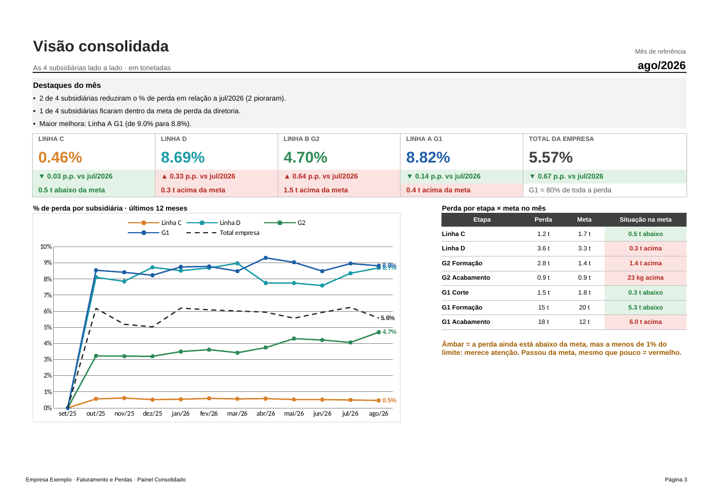
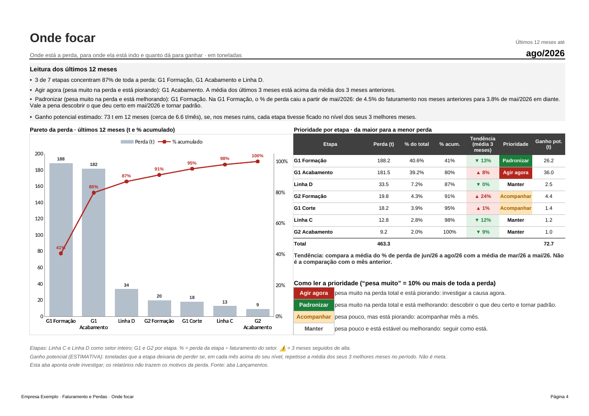
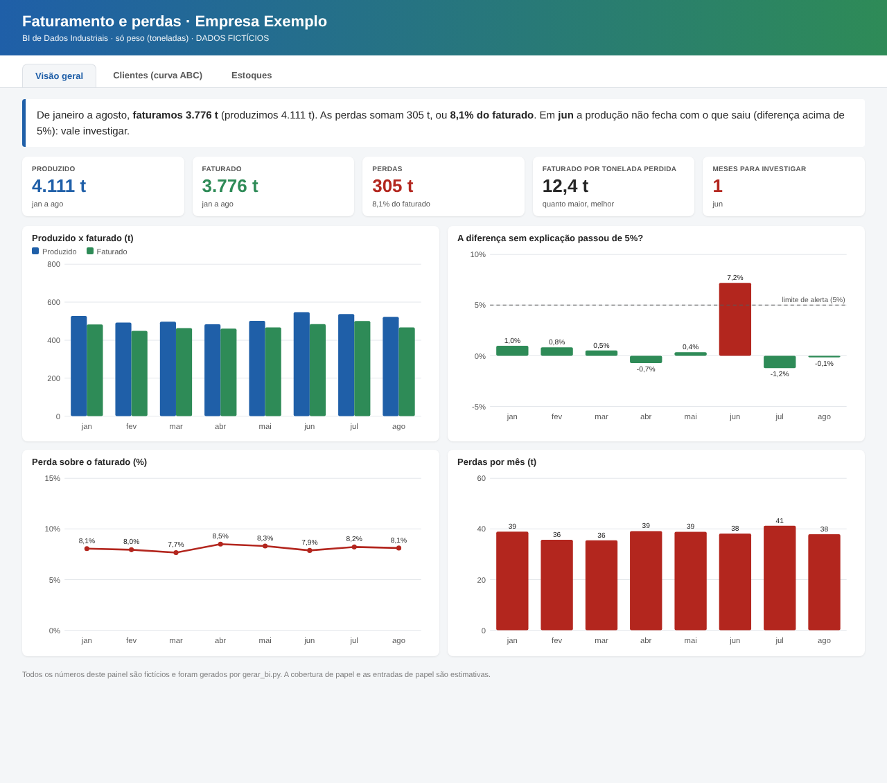
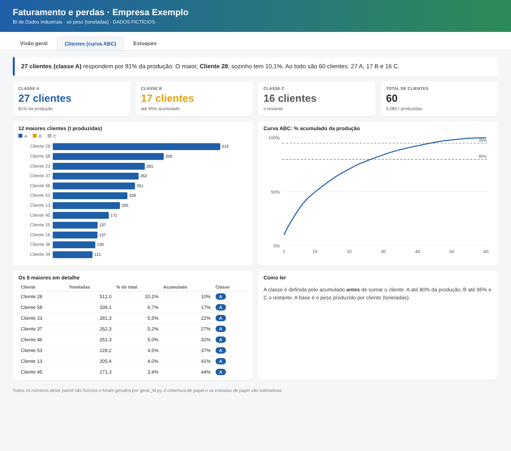
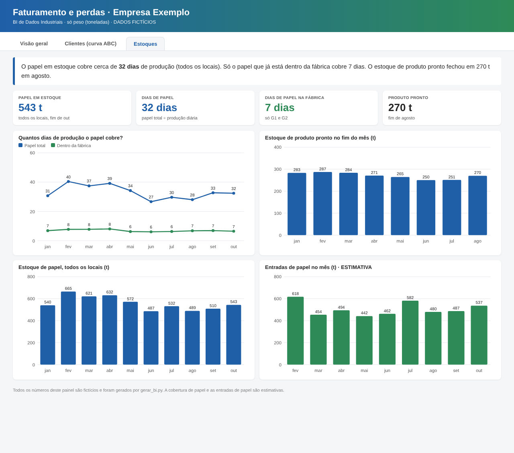

# Análise de faturamento e perdas

Projeto de **análise de dados para a indústria**: transformar relatórios mensais de faturamento e perdas de produção em uma ferramenta que mostra à diretoria, em poucos segundos, o que melhorou, o que piorou e **onde agir primeiro**.

> **Todos os dados deste repositório são fictícios.** Os números, as metas, os clientes e o nome da empresa foram inventados para demonstrar o método. O projeto nasceu de uma necessidade real e foi refeito aqui sem nenhuma informação da empresa.

## Em resumo

| | |
|---|---|
| **Problema** | Os relatórios de perda chegavam soltos, por setor, sem comparação entre meses nem indicação de onde estava o maior problema. |
| **O que foi entregue** | 1) Planilha em Excel com painéis automáticos para a diretoria · 2) Análise *Onde focar* com proposta de ação 5W2H · 3) BI em Python que cruza produção, faturamento, perdas e estoques · 4) Modelo em Power BI (esquema estrela + DAX). |
| **Indicadores** | % de perda sobre o faturamento, perda × meta, tendência de 3 meses, Pareto por etapa, ganho potencial, balanço de peso, curva ABC de clientes, cobertura de estoque. |
| **Ferramentas** | Excel (fórmulas, formatação condicional, validação de dados), Python (pandas, openpyxl, matplotlib), Power BI (modelagem e DAX), HTML/SVG. |
| **Métodos** | Pareto, curva ABC, 5W2H, benchmark interno, conferência de totais (balanço de massa). |

**Navegação rápida:** [Dashboard online](https://mazeik.github.io/analise-faturamento-perdas/bi_dados_industriais/dashboard/) · [Planilha](#o-que-a-planilha-faz) · [Onde focar + 5W2H](#onde-focar-da-análise-à-ação) · [BI e dashboard](#bi-de-dados-industriais-python--pandas) · [Power BI](#power-bi) · [Decisões de projeto](#decisões-de-projeto)

## O problema

A coordenação precisava de uma planilha em que bastasse lançar os números do mês para ver:

- o **% de perda sobre o faturamento** (indicador principal);
- a comparação com o **mês anterior** e com o **mesmo mês do ano anterior**;
- se a perda ficou **dentro ou fora da meta** definida pela diretoria;
- **onde está a perda** e para onde ela está indo, para decidir onde agir.

## O que a planilha faz

| Aba | Para que serve |
|---|---|
| Instruções | Passo a passo mensal para quem lança os dados |
| Lançamentos | Única aba de digitação: faturamento e perdas em kg (células coloridas, com validação de dados) |
| Painel Consolidado | As 4 subsidiárias lado a lado, com destaques automáticos em texto |
| Onde focar | Pareto da perda por etapa, tendência de 3 meses, prioridade de ação e ganho potencial |
| Painéis por subsidiária | Cartões e gráficos de cada setor (faturamento × % de perda, perda × meta) |
| Resumo | Tabela de consulta: mês × mês de comparação, acumulado do ano e mapa de calor de 12 meses |
| Metas | Metas de perda por setor/etapa, com data de vigência (a meta pode mudar sem apagar o histórico) |
| Financeiro (opcional) | Custo da perda em R$ e preço médio |

Tudo é **fórmula do Excel**: ao lançar um novo mês, painéis, gráficos e frases se atualizam sozinhos. Python só é necessário para gerar ou alterar a planilha, não para usá-la.

## Indicadores e regras

- **% de perda** = perda ÷ faturamento.
- **Mês anterior:** comparado pelo % de perda (justo entre meses com volumes diferentes). Verde = melhorou, vermelho = piorou.
- **Meta:** limite máximo de perda em toneladas. Verde abaixo da meta, âmbar a menos de 1% do limite (atenção), vermelho acima.
- **Tendência:** média do % de perda dos últimos 3 meses × média dos 3 meses anteriores, para não reagir a um mês isolado.
- **Prioridade:** uma etapa "pesa muito" quando responde por 10% ou mais da perda dos últimos 12 meses.
  - *Agir agora*: pesa muito e está piorando.
  - *Padronizar*: pesa muito e está melhorando (descobrir o que deu certo).
  - *Acompanhar*: pesa pouco, mas está piorando.
  - *Manter*: pesa pouco e está estável ou melhorando.
- **Ganho potencial (estimativa):** toneladas que a etapa deixaria de perder se, nos meses ruins, repetisse a média dos seus 3 melhores meses.

## Prévia (dados fictícios)





*Prévia renderizada pelo LibreOffice; no Excel, o gráfico não plota meses sem dado.*

## Como usar

```bash
pip install -r requirements.txt
python gerador_planilha.py Faturamento_e_Perdas_exemplo.xlsx
```

Ou abra direto o arquivo de exemplo: [`Faturamento_e_Perdas_exemplo.xlsx`](Faturamento_e_Perdas_exemplo.xlsx). Requer **Excel 2019 ou mais novo** (usa `MAXIFS` e `EDATE`).

## Onde focar: da análise à ação

A aba *Onde focar* aponta quais etapas concentram a perda e para onde ela está indo. O documento [`docs/onde-focar-5w2h.md`](docs/onde-focar-5w2h.md) mostra como transformar isso em decisão: resumo executivo, três achados, o cálculo do ganho potencial passo a passo e uma proposta **5W2H** para a etapa prioritária.

## BI de Dados Industriais (Python + pandas)

A segunda parte do projeto cruza **produção, faturamento, perdas e estoques**, só em peso (toneladas), para responder três perguntas: o balanço de peso fecha? quais clientes concentram a produção? quantos dias de produção o papel em estoque cobre? Está em [`bi_dados_industriais/`](bi_dados_industriais/) e roda com dados fictícios:

```bash
python bi_dados_industriais/gerar_bi.py          # gera as tabelas e os gráficos
python bi_dados_industriais/gerar_dashboard.py   # monta o dashboard em HTML e tira os prints (precisa do Google Chrome)
```

**[Abrir o dashboard online](https://mazeik.github.io/analise-faturamento-perdas/bi_dados_industriais/dashboard/)** (três abas, funciona no navegador e no celular). O código está em [`bi_dados_industriais/dashboard/index.html`](bi_dados_industriais/dashboard/index.html). Cada aba começa por uma frase-resumo em linguagem simples, seguida dos cartões e dos gráficos.

**Visão geral:** o que foi produzido, faturado e perdido, e se o balanço fecha.



**Clientes (curva ABC):** quem concentra a produção.



**Estoques:** dias de cobertura do papel e estoque de produto pronto.



| Pergunta | Como é respondida |
|---|---|
| **O balanço de peso fecha?** | Produção = faturado + perdas + variação do estoque de produto pronto. A diferença em % é calculada por mês e gera alerta acima de ±5%. |
| **Quem concentra a produção?** | Curva ABC de clientes: A até 80% da produção acumulada, B até 95%, C o resto. |
| **Quantos dias o papel cobre?** | Estoque de papel ÷ consumo diário, com e sem o papel que está fora da fábrica. As entradas de papel são marcadas como *estimativa*. |

Os gráficos de `gerar_bi.py` (em `bi_dados_industriais/graficos/`) mostram as mesmas análises em imagens avulsas.

O script confere os próprios números antes de gerar os gráficos (produção = soma das ordens, curva ABC fecha com a produção, balanço fecha). O alerta de junho no dashboard é proposital: foi inserido nos dados fictícios para mostrar como um mês fora do padrão aparece.

**Uma base só para tudo:** a planilha, o BI e o Power BI leem os mesmos dados fictícios ([`dados_ficticios.py`](dados_ficticios.py)). O faturamento de G1 + G2 de jan a ago/2026 é **3.776,1 t** nas três partes, e o script do BI confere isso antes de gerar os gráficos.

## Power BI

A mesma análise em Power BI, com **modelo em esquema estrela** (dimensões de calendário, setor, etapa e cliente; fatos de faturamento, perdas, metas, ordens e estoque) e **medidas DAX comentadas**: % de perda, comparação com o mês anterior, situação na meta, Pareto, tendência de 3 meses, prioridade, balanço de peso e curva ABC.

```bash
python powerbi/gerar_modelo.py   # gera as tabelas em powerbi/dados/
```

O passo a passo de montagem, os relacionamentos e todas as medidas estão em [`powerbi/README.md`](powerbi/README.md).

## Estrutura

```
requirements.txt                     # bibliotecas Python usadas
dados_ficticios.py                   # base fictícia única (planilha, BI e Power BI leem daqui)
gerador_planilha.py                  # monta a planilha de faturamento e perdas (dados fictícios)
Faturamento_e_Perdas_exemplo.xlsx    # resultado do script
docs/onde-focar-5w2h.md              # análise "Onde focar" + proposta 5W2H (dados fictícios)
bi_dados_industriais/
  gerar_bi.py                        # BI: balanço de peso, curva ABC, cobertura de papel
  gerar_dashboard.py                 # dashboard em HTML (SVG) + prints das 3 abas
  dashboard/index.html               # dashboard pronto, abre no navegador
  saida/                             # tabelas em CSV geradas pelo script
  graficos/                          # gráficos e prints do dashboard (README)
powerbi/
  gerar_modelo.py                    # monta as tabelas do esquema estrela
  dados/                             # CSVs para importar no Power BI
  README.md                          # relacionamentos e medidas DAX comentadas
docs/*.png                           # prévias da planilha
```

## Decisões de projeto

- **Dados originais intocados:** a planilha só lê o que é lançado em *Lançamentos*; todo o resto é cálculo.
- **Meta em toneladas, não em %:** respeita o critério definido pela diretoria. A meta fixa não acompanha o volume, o que fica como ponto de atenção a discutir.
- **Aba de cálculo oculta** (`Cálculos`), com uma linha por mês, para os painéis ficarem simples de ler e de auditar.
- **Linguagem simples nos painéis:** o material é pensado para ser apresentado à diretoria sem explicação técnica.
- **No BI, só peso:** valores em R$ ficam fora de propósito; o foco é a operação.
- **Sem "dias de estoque" de produto pronto:** os itens ficam em processo ou esperando a etapa seguinte e não aguardam pedido, então esse indicador enganaria. O BI mostra só o estoque em toneladas. Para o papel, os dias de cobertura foram mantidos.
- **Curva ABC pela produção:** nomes de clientes só devem ser unificados quando houver erro de escrita; unidades diferentes da mesma empresa ficam separadas.

## Próximos passos possíveis

- Arquivo `.pbix` com as páginas sugeridas e prints no README.
- Ler os lançamentos direto das fontes (pandas) para reduzir a digitação.
- Padronizar códigos de papel e nomes de clientes para uma curva ABC mais precisa.
- Acompanhar o plano 5W2H e medir se o % de perda da etapa prioritária voltou ao nível de referência.

## Autor

**John Wesley da Silva**: Engenheiro de Produção, pós-graduado em Engenharia de Processos. Trabalho com processos, qualidade, planejamento e logística, e uso análise de dados (Excel, Power BI, Python e SQL) para apoiar decisões na operação.

[LinkedIn](https://www.linkedin.com/in/john-wesley-da-silva/)

Projeto desenvolvido com apoio do Claude (Anthropic) como assistente de programação e revisão.
